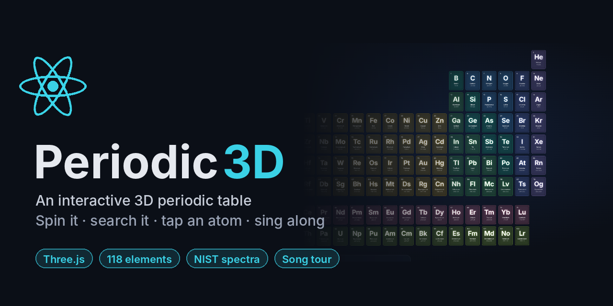
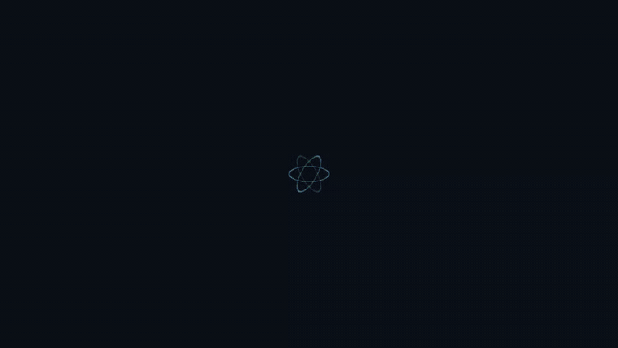
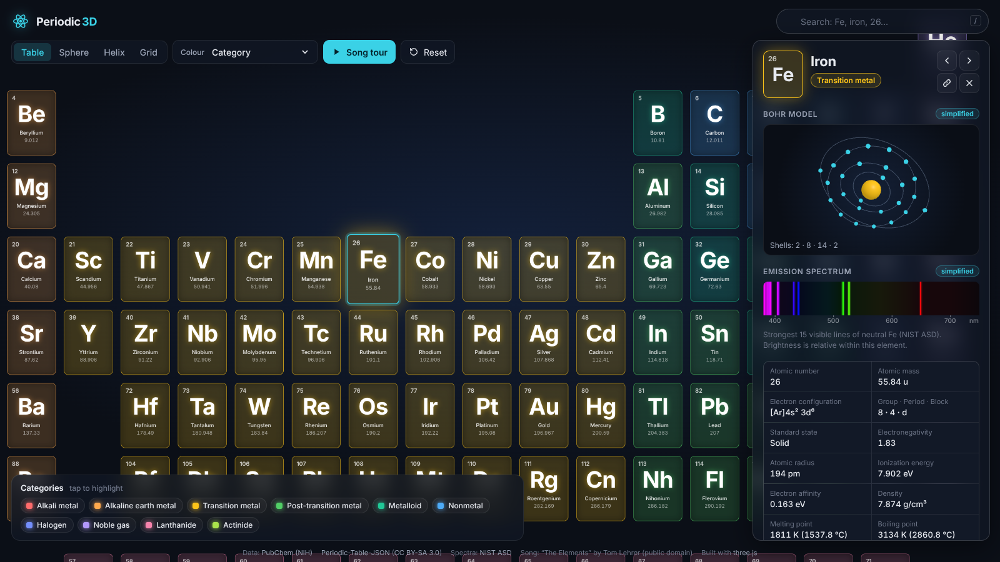
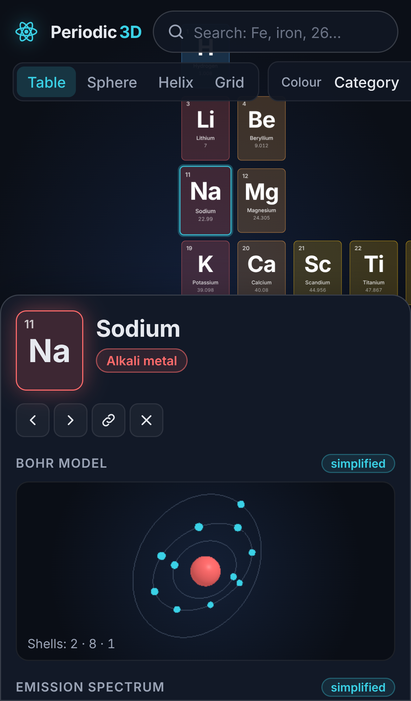
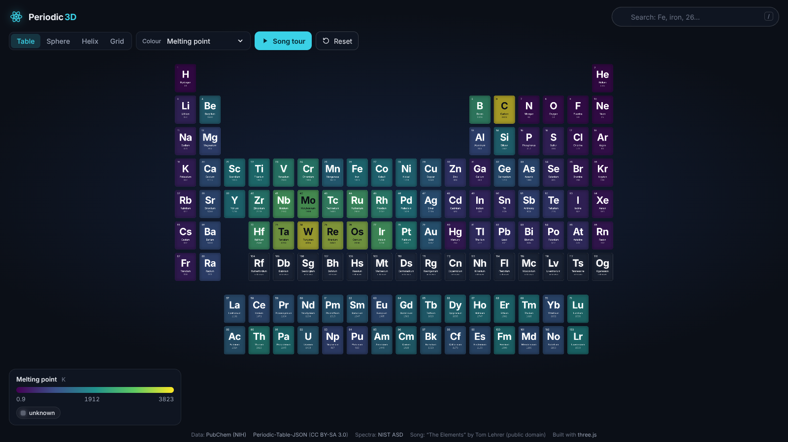
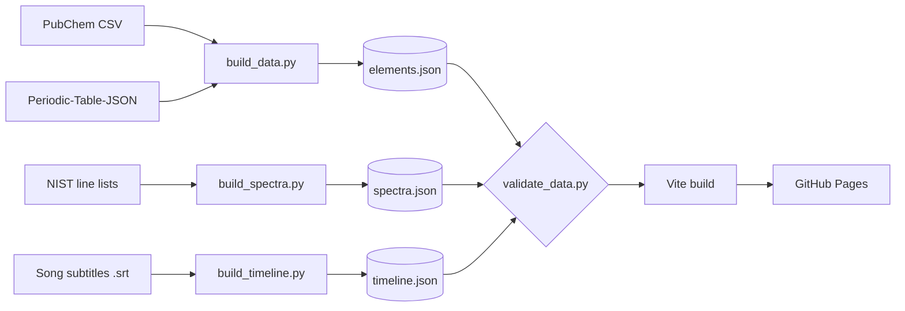

<div align="center">

<a href="https://dark3993fury.github.io/periodic3d/"></a>

# Periodic 3D

**Spin it. Search it. Tap an atom. Sing along.**

An interactive 3D periodic table that runs in any browser, on desktop or phone. No install, no sign-up.

[](https://dark3993fury.github.io/periodic3d/)

[](https://github.com/Dark3993Fury/periodic3d/actions/workflows/deploy.yml)


[](LICENSE)
[](#data-sources)



</div>

## ✨ What it does

| | |
| --- | --- |
| 🧊 **118 elements in 3D** | Drag to rotate, scroll or pinch to zoom. Tiles assemble on load and idle-sway until you touch them. |
| 🌀 **Four layouts** | Table, sphere, helix and grid, with smooth animated transitions. |
| ⚛️ **Atom view** | Tap any element for its facts, an animated Bohr model built from its electron shells, and its real visible emission lines from NIST. |
| 🌡️ **Melt the table** | Slide from 0 K to 6000 K and watch elements turn solid, liquid or gas. |
| 🔥 **Heatmaps** | Recolour by electronegativity, atomic radius, density (log scale), melting point or ionization energy. |
| 🔎 **Instant search** | Type `Fe`, `iron` or `26` and the camera flies there. Even `aluminium` and `sulphur` work. |
| 🎵 **Song tour** | Press play and the camera visits all 102 elements in Tom Lehrer's *The Elements*, in time with the song. |
| 🔗 **Share an element** | `…/periodic3d/#Au` opens with gold already selected. |
| 📱 **Works everywhere** | Phone layout with a bottom sheet, automatic low-detail mode, keyboard navigation, honours *reduce motion*, and still works without WebGL. |

## 📸 Screenshots

<table>
  <tr>
    <td width="66%"></td>
    <td rowspan="2"></td>
  </tr>
  <tr>
    <td></td>
  </tr>
</table>

## 🧪 Things to try

- Set colour to **State at temperature** and drag to **5772 K**, the surface of the Sun. Count what's still solid.
- Drag back to **298 K** (room temperature): only two elements are liquid. Which ones?
- Open the **spectrum** of hydrogen, then sodium. That bright yellow line is why old street lights glowed orange-yellow.
- Switch to **Sphere** and spin it fast.
- Press **Song tour** and try to keep up with Tom Lehrer.

## ⌨️ Controls

| Action | Mouse / touch | Keyboard |
| --- | --- | --- |
| Rotate / zoom / pan | Drag / scroll or pinch / right-drag | |
| Select element | Tap a tile | `←` `→` `↑` `↓` |
| Search | Search box | `/` |
| Close panel or stop tour | ✕ or tap empty space | `Esc` |
| Play / pause song tour | ▶ button | `Space` |

## 🛠️ Run it locally

Requires [Node.js](https://nodejs.org) 20+ (22 LTS recommended).

```bash
git clone https://github.com/Dark3993Fury/periodic3d.git
cd periodic3d
npm install
npm run dev        # → http://localhost:5173/periodic3d/
```

```bash
npm run build      # production build into dist/
npm run preview    # serve dist/ exactly like GitHub Pages does
npm run data       # rebuild + validate all data files (needs Python 3)
```

Every push to `main` validates the data, builds the site and deploys it to GitHub Pages ([workflow](.github/workflows/deploy.yml)).

## 🧬 How it works



- **No element facts live in the code.** Everything shown comes from the generated JSON, and a missing value shows as *unknown*, never 0.
- **Tiles are HTML in 3D** ([`CSS3DRenderer`](https://threejs.org/docs/#examples/en/renderers/CSS3DRenderer)), so the text stays crisp and the table works even without WebGL. Only the small Bohr-model view uses WebGL.
- **Vanilla JS modules, one job each.** No framework.

<details>
<summary><b>Project structure</b></summary>

```
src/
  main.js              wires everything together
  data/loader.js       fetch + cache JSON
  scene/setup.js       renderer, camera, controls, camera flights
  scene/layouts.js     table / sphere / helix / grid positions
  scene/tiles.js       the 118 tiles: build, move, colour, pick
  scene/atom.js        Bohr model (WebGL)
  ui/panel.js          element detail panel
  ui/spectrum.js       emission spectrum drawing
  ui/legend.js         category / heatmap / state legend
  ui/controls.js       search + toolbar
  ui/colors.js         palettes, heatmap ramp, wavelength → colour
  ui/theme.css         all styling
  features/tour.js     song tour (audio ↔ camera sync)
  features/keyboard.js keyboard navigation
  utils/               state + URL hash, tweening, formatting, device checks
scripts/
  build_data.py  build_spectra.py  build_timeline.py  validate_data.py
  raw/                 the original source files
public/
  data/                generated JSON (never edit by hand)
  audio/               the song
```
</details>

<details>
<summary><b>Tuning the song tour</b></summary>

Timings in `public/data/timeline.json` come from a subtitle file of the recording (`scripts/raw/the-elements.srt`). `scripts/build_timeline.py` places each element by where its name falls in each subtitle line, and corrects words the transcription misheard.

- Camera slightly early or late everywhere: change `LEAD` in `scripts/build_timeline.py`, then run `python3 scripts/build_timeline.py`.
- One element off: edit its `t` (seconds) in `public/data/timeline.json`.
- No MP3? The tour still runs silently.
</details>

## 📚 Data sources

| Source | Used for | Licence |
| --- | --- | --- |
| [PubChem Periodic Table](https://pubchem.ncbi.nlm.nih.gov/periodic-table/) (NIH) | Mass, configuration, electronegativity, radius, ionization energy, electron affinity, melting/boiling point, density, category, year discovered | Public domain |
| [Bowserinator/Periodic-Table-JSON](https://github.com/Bowserinator/Periodic-Table-JSON) | Electron shells, table positions, summaries, appearance, discoverer | CC BY-SA 3.0 |
| [NIST Atomic Spectra Database](https://physics.nist.gov/asd) | 15 strongest observed visible lines (380–750 nm) per neutral atom, Z = 1–99 | US Government work |
| [“The Elements”, Tom Lehrer](https://commons.wikimedia.org/wiki/File:1-16_The_Elements.mp3) | Song tour audio (*The Remains of Tom Lehrer*, 2000) | Public domain, released by the author |

Notes: astatine, francium and elements above 99 have no observed visible lines in NIST, so their spectrum shows *no data*. “State at temperature” assumes 1 atm and uses melting/boiling points. Bohr models and spectra are deliberately simplified.

## 📄 License

- **Code:** [MIT](LICENSE)
- **Generated element data** (`public/data/elements.json`): CC BY-SA 3.0, because it includes content from Periodic-Table-JSON
- **Song:** public domain (Tom Lehrer)

Made with curiosity, [three.js](https://threejs.org) and a little help from AI. If it made you smile, a ⭐ is appreciated.
